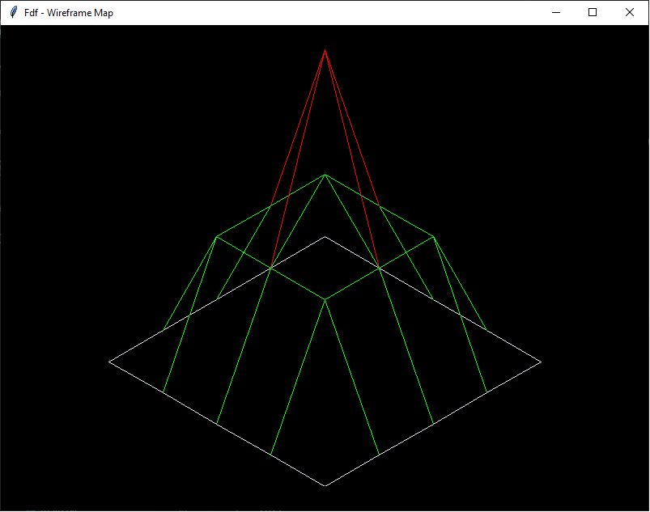

# FdF — каркасная 3D-модель карты высот



## Описание

FdF — программа для визуализации карты высот в виде трёхмерной каркасной модели.

Проект реализован на Python. Карта высот преобразуется в геометрическую модель и отображается в изометрической проекции. Программа поддерживает отображение цветных точек и построение каркасной модели карты.

## Установка и запуск

### Требования

- Python 3.12 или новее
- Tkinter
- Git

### Клонирование репозитория

```bash
git clone https://github.com/AliveForCoding/fdf-python.git
cd fdf-python
```

### Создание виртуального окружения

Для Windows (PowerShell):

```powershell
python -m venv .venv
.venv\Scripts\activate
```

### Установка инструментов проверки

```bash
python -m pip install pytest mypy ruff
```

### Запуск программы

Запуск карты рельефа:

```bash
python main.py maps/relief.fdf
```

Запуск цветной карты:

```bash
python main.py maps/colors.fdf
```

## Управление

| Клавиша / действие | Результат |
|---|---|
| `Esc` | Выход из программы |
| Закрытие окна | Завершение программы |

## Формат карты

Файл карты содержит строки с высотами точек. Каждая строка должна содержать одинаковое количество точек.

- Высоты задаются целыми числами.
- Поддерживаются отрицательные высоты.
- Цвет точки можно указать в формате `0xRRGGBB`.
- Карта может содержать как цветные, так и обычные точки.
- Допускаются короткие записи цвета, если ведущие нули отсутствуют.
- Пустые строки в конце файла игнорируются.

Пример карты:

```text
0 0 0 0
0 5 5 0
0 5 0 0
0 0 0 0
```

Пример карты с цветами:

```text
0 0xFF0000 0
0 5 0x00FF00
0x0000FF 0 0
```

## Структура проекта

```
fdf-python/
├── fdf/
│   ├── __init__.py
│   ├── interface.py
│   ├── model.py
│   ├── parser.py
│   └── projection.py
├── maps/
│   ├── colors.fdf
│   ├── flat.fdf
│   ├── relief.fdf
│   ├── test.fdf
│   └── bad/
│       ├── invalid_color.fdf
│       ├── invalid_z.fdf
│       └── uneven.fdf
├── tests/
│   └── test_parser.py
├── docs/
│   └── colors.png
├── main.py
├── README.md
├── LICENSE
└── .gitignore
```

## Тесты

Запуск тестов:

```bash
python -m pytest -q
```

Проверка типов:

```bash
mypy --strict fdf main.py
```

Проверка кода:

```bash
ruff check .
```

## Лицензия

Проект распространяется под лицензией MIT. Подробности находятся в файле `LICENSE`.